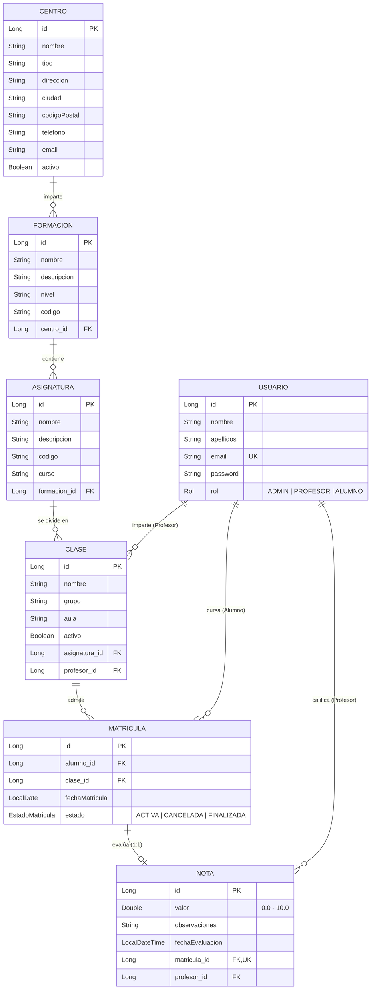

# 🎓 Gestión Baleras - API REST

[](https://openjdk.org/projects/jdk/21/)
[](https://spring.io/projects/spring-boot)
[](https://spring.io/projects/spring-security)
[](https://www.postgresql.org/)
[](#-suite-de-pruebas-y-calidad-de-código)
[](#)

API REST robusta, modular y escalable para la gestión académica y administrativa integral de centros educativos e institutos de formación profesional (**Gestión Baleras**). Implementa una arquitectura en capas desacopladas, autenticación stateless basada en tokens criptográficos **JWT (JSON Web Token)**, autorización granular por roles (**RBAC: ADMIN, PROFESOR, ALUMNO**), validaciones declarativas estrictas de entrada y una exhaustiva suite de **329 pruebas unitarias** con Mockito y WebMvcTest.

---

## 📋 Tabla de Contenidos

1. [Descripción y Propósito](#-descripción-y-propósito)
2. [Arquitectura del Sistema](#-arquitectura-del-sistema)
3. [Modelo de Dominio y Entidades](#-modelo-de-dominio-y-entidades)
4. [Seguridad y Control de Acceso (RBAC)](#-seguridad-y-control-de-acceso-rbac)
5. [Estructura del Proyecto](#-estructura-del-proyecto)
6. [Catálogo de Endpoints de la API](#-catálogo-de-endpoints-de-la-api)
   - [Autenticación (`/api/auth`)](#1-autenticación-apiauth)
   - [Centros (`/api/centros`)](#2-centros-apicentros)
   - [Formaciones (`/api/formaciones`)](#3-formaciones-apiformaciones)
   - [Asignaturas (`/api/asignaturas`)](#4-asignaturas-apiasignaturas)
   - [Clases (`/api/clases`)](#5-clases-apiclases)
   - [Matrículas (`/api/matriculas`)](#6-matrículas-apimatriculas)
   - [Calificaciones / Notas (`/api/notas`)](#7-calificaciones--notas-apinotas)
   - [Usuarios (`/api/usuarios`)](#8-usuarios-apiusuarios)
7. [Manejo Centralizado de Excepciones](#-manejo-centralizado-de-excepciones)
8. [Configuración y Variables de Entorno](#-configuración-y-variables-de-entorno)
9. [Instalación y Despliegue Local](#-instalación-y-despliegue-local)
10. [🧪 Suite de Pruebas y Calidad de Código](#-suite-de-pruebas-y-calidad-de-código)
11. [Flujo de Ejemplo con cURL](#-flujo-de-ejemplo-con-curl)
12. [Tecnologías Empleadas](#-tecnologías-empleadas)

---

## 💡 Descripción y Propósito

**Gestión Baleras** da soporte al ecosistema académico completo de un centro educativo:
- **Estructura Académica:** Jerarquía relacional integral: Centros formativos $\rightarrow$ Formaciones (ciclos DAM, DAW, etc.) $\rightarrow$ Asignaturas $\rightarrow$ Clases (aulas y turnos).
- **Gestión de Usuarios:** Separación estricta de identidades entre Administradores, Profesores y Alumnos.
- **Matriculación:** Inscripción de estudiantes con control de estados (`ACTIVA`, `CANCELADA`, `FINALIZADA`) y restricción de unicidad (evita matriculaciones duplicadas del mismo alumno en una clase).
- **Evaluación y Calificaciones:** Emisión, actualización y consulta de notas numéricas (rango 0.0 a 10.0) con observaciones. Garantía de integridad: **únicamente el docente titular de la clase** tiene autorización para calificar a los alumnos inscritos en ella.

---

## 🏛️ Arquitectura del Sistema

El proyecto sigue una arquitectura en capas (**Layered Architecture**) limpia y modular:

```text
                  ┌─────────────────────────────────┐
                  │     Cliente HTTP / Postman      │
                  └────────────────┬────────────────┘
                                   │ HTTP Request + Authorization Bearer <JWT>
                                   ▼
                  ┌─────────────────────────────────┐
                  │     JwtAuthenticationFilter     │  <- Extrae claims, valida firma y establece SecurityContext
                  └────────────────┬────────────────┘
                                   │
                  ┌────────────────▼────────────────┐
                  │          Controllers            │  <- Validación de DTOs (@Valid), @PreAuthorize (Roles)
                  └────────────────┬────────────────┘
                                   │ DTOs (Java Records inmutables)
                  ┌────────────────▼────────────────┐
                  │           Services              │  <- Reglas de negocio y comprobación de titularidad
                  └────────────────┬────────────────┘
                                   │ Entidades de Dominio JPA
                  ┌────────────────▼────────────────┐
                  │          Repositories           │  <- Spring Data JPA (PostgreSQL)
                  └────────────────┬────────────────┘
                                   │ SQL (Hibernate ORM 7)
                  ┌────────────────▼────────────────┐
                  │       PostgreSQL Database       │
                  └─────────────────────────────────┘
```

---

## 🗄️ Modelo de Dominio y Entidades

### Diagrama Entidad-Relación



### Reglas de Integridad Clave:
1. **Unicidad de Matrícula (`uk_alumno_clase`):** Un alumno no puede matricularse dos veces en una misma clase activa.
2. **Unicidad de Calificación (`uk_nota_matricula`):** Relación 1:1 estricta entre una matrícula y su nota final.
3. **Credencial única:** El email de cada usuario debe ser único en el sistema.
4. **Verificación de Titularidad Docente:** Solo el docente asignado a la clase puede calificar las matrículas de la misma; un intento de calificación por parte de otro docente genera una excepción `AccessDeniedException` (HTTP 403 Forbidden).

---

## 🔐 Seguridad y Control de Acceso (RBAC)

El proyecto utiliza **Spring Security** en modo **Stateless** con **JWT (JSON Web Token)** y **BCryptPasswordEncoder** para almacenar contraseñas mediante hash irreversible con salting automático.

### Matriz de Permisos por Rol

| Módulo / Recurso | Operación | ADMIN | PROFESOR | ALUMNO | Observaciones |
| :--- | :--- | :---: | :---: | :---: | :--- |
| **Auth** | Registro (`/register`) | ✅ | ✅ | ✅ | Endpoint público. Asigna rol `ALUMNO` por defecto. |
| **Auth** | Login (`/login`) | ✅ | ✅ | ✅ | Endpoint público. Devuelve token JWT firmado (duración: 1h). |
| **Usuarios** | Listado general / Por ID | ✅ | ✅ | ❌ | Consulta de datos de usuarios. |
| **Usuarios** | Crear / Modificar / Borrar | ✅ | ❌ | ❌ | Gestión de usuarios reservada a Secretaría/Admin. |
| **Centros** | Lectura (`GET`) | ✅ | ✅ | ❌ | Consulta de información de centros. |
| **Centros** | Crear / Modificar / Borrar | ✅ | ❌ | ❌ | Administración de sedes. |
| **Formaciones** | Lectura (`GET`) | ✅ | ✅ | ❌ | Catálogo de formaciones disponibles. |
| **Formaciones** | Crear / Modificar / Borrar | ✅ | ❌ | ❌ | Configuración de planes formativos. |
| **Asignaturas** | Lectura (`GET`) | ✅ | ✅ | ❌ | Materias del plan formativo. |
| **Asignaturas** | Crear / Modificar / Borrar | ✅ | ❌ | ❌ | Configuración curricular. |
| **Clases** | Lectura (`GET /api/clases`) | ✅ | 🔍 *(Propias)* | ❌ | Profesores solo ven sus clases asignadas. |
| **Clases** | Mis clases (`/mis-clases`) | ❌ | ✅ | ❌ | Consulta directa para el docente autenticado. |
| **Clases** | Crear / Modificar / Borrar | ✅ | ❌ | ❌ | Creación de grupos y asignación de profesores. |
| **Matrículas** | Por Clase (`/clase/{id}`) | ✅ | 🔍 *(Propias)* | ❌ | El docente consulta los alumnos de su clase. |
| **Matrículas** | Por Alumno (`/alumno/{id}`) | ✅ | 🔍 *(Si le da clase)* | 🔍 *(Solo suyas)* | El alumno solo consulta sus propias matrículas. |
| **Matrículas** | Crear / Modificar / Borrar | ✅ | ❌ | ❌ | Trámite administrativo exclusivo de Secretaría. |
| **Notas** | Listado general | ✅ | ✅ | ❌ | Auditoría de calificaciones. |
| **Notas** | Mis notas (`/mis-notas`) | ❌ | ❌ | ✅ | El alumno consulta exclusivamente sus calificaciones. |
| **Notas** | Crear / Modificar / Borrar | ❌ | 🔍 *(Titular)* | ❌ | **Solo el profesor titular** de la clase puede calificar. |

---

## 📁 Estructura del Proyecto

```text
Gestion Baleras/
├── pom.xml                                     # Dependencias Maven, plugins y configuración de compilación
├── mvnw / mvnw.cmd                             # Maven Wrapper portable (Linux/macOS y Windows)
├── .env                                        # Variables de entorno locales para PostgreSQL y JWT
├── src/
│   ├── main/
│   │   ├── java/com/baleras/api/
│   │   │   ├── GestionBalerasApplication.java  # Clase principal Spring Boot (@SpringBootApplication)
│   │   │   ├── config/                         # Configuraciones (Security, JWT)
│   │   │   │   ├── JwtConfig.java              # @ConfigurationProperties para prefijo 'jwt'
│   │   │   │   └── SecurityConfig.java         # SecurityFilterChain, BCrypt, rutas públicas y privadas
│   │   │   ├── Controller/                     # Endpoints REST (Controladores MVC)
│   │   │   │   ├── AsignaturaController.java
│   │   │   │   ├── AuthController.java
│   │   │   │   ├── CentroController.java
│   │   │   │   ├── ClaseController.java
│   │   │   │   ├── FormacionController.java
│   │   │   │   ├── MatriculaController.java
│   │   │   │   ├── NotaController.java
│   │   │   │   └── UsuarioController.java
│   │   │   ├── Dto/                            # DTOs de Entrada y Salida (Java Records)
│   │   │   │   ├── AsignaturaRequest.java / AsignaturaResponse.java
│   │   │   │   ├── AuthRequest.java / AuthResponse.java
│   │   │   │   ├── CentroRequest.java / CentroResponse.java
│   │   │   │   ├── ClaseRequest.java / ClaseResponse.java
│   │   │   │   ├── FormacionRequest.java / FormacionResponse.java
│   │   │   │   ├── MatriculaRequest.java / MatriculaResponse.java
│   │   │   │   ├── NotaRequest.java / NotaResponse.java
│   │   │   │   └── UsuarioRequest.java / UsuarioResponse.java
│   │   │   ├── Entity/                         # Entidades JPA y Enumerados de Dominio
│   │   │   │   ├── Asignatura.java, Centro.java, Clase.java, Formacion.java
│   │   │   │   ├── Matricula.java, Nota.java, Usuario.java
│   │   │   │   ├── EstadoMatricula.java        # ACTIVA, CANCELADA, FINALIZADA
│   │   │   │   └── Rol.java                    # ADMIN, PROFESOR, ALUMNO
│   │   │   ├── Exception/                      # Gestión global de errores y excepciones
│   │   │   │   ├── AccessDeniedException.java
│   │   │   │   ├── ApiError.java               # Estructura JSON estandarizada de error
│   │   │   │   ├── DuplicateResourceException.java
│   │   │   │   ├── GlobalExceptionHandler.java # @RestControllerAdvice centralizado
│   │   │   │   ├── InvalidCredentialException.java
│   │   │   │   └── ResourceNotFoundException.java
│   │   │   ├── Repository/                     # Interfaces Spring Data JPA
│   │   │   ├── Security/                       # Componentes de seguridad JWT
│   │   │   │   └── JwtAuthenticationFilter.java# Filtro OncePerRequestFilter
│   │   │   └── Service/                        # Capa de lógica de negocio y autorizaciones
│   │   │       ├── AsignaturaService.java
│   │   │       ├── AuthService.java
│   │   │       ├── CentroService.java
│   │   │       ├── ClaseService.java
│   │   │       ├── FormacionService.java
│   │   │       ├── JwtService.java
│   │   │       ├── MatriculaService.java
│   │   │       ├── NotaService.java
│   │   │       ├── UsuarioActualService.java
│   │   │       └── UsuarioService.java
│   │   └── resources/
│   │       └── application.properties          # Configuración parametrizada con variables de entorno
│   └── test/
│       └── java/com/baleras/api/
│           ├── Controller/                     # Pruebas de integración HTTP (@WebMvcTest - 201 tests)
│           │   ├── AsignaturaControllerTest.java
│           │   ├── AuthControllerTest.java
│           │   ├── CentroControllerTest.java
│           │   ├── ClaseControllerTest.java
│           │   ├── FormacionControllerTest.java
│           │   ├── MatriculaControllerTest.java
│           │   ├── NotaControllerTest.java
│           │   ├── TestSecurityConfig.java     # Configuración de seguridad para WebMvcTest
│           │   └── UsuarioControllerTest.java
│           └── Service/                        # Pruebas unitarias de negocio (Mockito - 128 tests)
│               ├── AsignaturaServiceTest.java
│               ├── AuthServiceTest.java
│               ├── CentroServiceTest.java
│               ├── ClaseServiceTest.java
│               ├── FormacionServiceTest.java
│               ├── MatriculaServiceTest.java
│               ├── NotaServiceTest.java
│               └── UsuarioServiceTest.java
```

---

## 📡 Catálogo de Endpoints de la API

> 💡 **Autenticación requerida:** Salvo en `/api/auth/**`, todas las peticiones deben incluir la cabecera HTTP:  
> `Authorization: Bearer <TOKEN_JWT>`

### 1. Autenticación (`/api/auth`)

| Método | Endpoint | Acceso | Descripción |
| :--- | :--- | :--- | :--- |
| `POST` | `/api/auth/register` | Público | Registra un nuevo estudiante (rol `ALUMNO`). |
| `POST` | `/api/auth/login` | Público | Autentica al usuario y devuelve el token JWT con su perfil. |

<details>
<summary>▶ Ver ejemplos de Request / Response (Auth)</summary>

**POST `/api/auth/login` - Request:**
```json
{
  "email": "profesor@baleras.com",
  "password": "Password123"
}
```

**POST `/api/auth/login` - Response (200 OK):**
```json
{
  "id": 1,
  "nombre": "Carlos",
  "email": "profesor@baleras.com",
  "rol": "PROFESOR",
  "token": "eyJhbGciOiJIUzI1NiJ9.eyJzdWIiOiJwcm9mZXNvckBiYWxlcmFzLmNvbSIsImlzcyI6IkJhbGVyYXMiLCJpYXQiOjE3OTM3MjE2MDAsImV4cCI6MTc5MzcyNTIwMH0..."
}
```
</details>

---

### 2. Centros (`/api/centros`)

| Método | Endpoint | Roles Permitidos | Descripción |
| :--- | :--- | :--- | :--- |
| `GET` | `/api/centros` | `ADMIN`, `PROFESOR` | Lista todos los centros educativos activos. |
| `GET` | `/api/centros/{id}` | `ADMIN`, `PROFESOR` | Obtiene los detalles de un centro por su ID. |
| `POST` | `/api/centros` | `ADMIN` | Registra una nueva sede o centro. |
| `PUT` | `/api/centros/{id}` | `ADMIN` | Actualiza la información de un centro existente. |
| `DELETE` | `/api/centros/{id}` | `ADMIN` | Elimina un centro del sistema. |

<details>
<summary>▶ Ver ejemplos de Request / Response (Centros)</summary>

**POST `/api/centros` - Request:**
```json
{
  "nombre": "Campus Baleras Palma",
  "tipo": "Centro Integrado de FP",
  "direccion": "Av. Alexandre Rosselló 15",
  "ciudad": "Palma de Mallorca",
  "codigoPostal": "07002",
  "telefono": "971000111",
  "email": "contacto@baleras-palma.edu"
}
```

**Response (201 Created):**
```json
{
  "id": 1,
  "nombre": "Campus Baleras Palma",
  "tipo": "Centro Integrado de FP",
  "direccion": "Av. Alexandre Rosselló 15",
  "ciudad": "Palma de Mallorca",
  "codigoPostal": "07002",
  "telefono": "971000111",
  "email": "contacto@baleras-palma.edu",
  "activo": true
}
```
</details>

---

### 3. Formaciones (`/api/formaciones`)

| Método | Endpoint | Roles Permitidos | Descripción |
| :--- | :--- | :--- | :--- |
| `GET` | `/api/formaciones` | `ADMIN`, `PROFESOR` | Lista todas las formaciones académicas. |
| `GET` | `/api/formaciones/{id}` | `ADMIN`, `PROFESOR` | Consulta una formación por ID. |
| `GET` | `/api/formaciones/centro/{centroId}` | `ADMIN`, `PROFESOR` | Ciclos y grados impartidos en un centro específico. |
| `POST` | `/api/formaciones` | `ADMIN` | Da de alta una nueva titulación asociada a un centro. |
| `PUT` | `/api/formaciones/{id}` | `ADMIN` | Modifica datos curriculares de la formación. |
| `DELETE` | `/api/formaciones/{id}` | `ADMIN` | Elimina una formación. |

---

### 4. Asignaturas (`/api/asignaturas`)

| Método | Endpoint | Roles Permitidos | Descripción |
| :--- | :--- | :--- | :--- |
| `GET` | `/api/asignaturas` | `ADMIN`, `PROFESOR` | Lista general de asignaturas. |
| `GET` | `/api/asignaturas/{id}` | `ADMIN`, `PROFESOR` | Obtiene una asignatura por su ID. |
| `GET` | `/api/asignaturas/formacion/{formacionId}` | `ADMIN`, `PROFESOR` | Asignaturas pertenecientes a un plan formativo. |
| `POST` | `/api/asignaturas` | `ADMIN` | Crea una asignatura ligada a una formación. |
| `PUT` | `/api/asignaturas/{id}` | `ADMIN` | Actualiza la información de una asignatura. |
| `DELETE` | `/api/asignaturas/{id}` | `ADMIN` | Da de baja una asignatura. |

---

### 5. Clases (`/api/clases`)

| Método | Endpoint | Roles Permitidos | Descripción |
| :--- | :--- | :--- | :--- |
| `GET` | `/api/clases` | `ADMIN`, `PROFESOR` | Lista de clases (Admin ve todas; Profesor solo las suyas). |
| `GET` | `/api/clases/{id}` | `ADMIN`, `PROFESOR` | Detalle de la clase (validando titularidad en docente). |
| `GET` | `/api/clases/mis-clases` | `PROFESOR` | Lista de clases asignadas al docente autenticado. |
| `GET` | `/api/clases/asignatura/{asignaturaId}` | `ADMIN`, `PROFESOR` | Grupos existentes para una asignatura. |
| `GET` | `/api/clases/profesor/{profesorId}` | `ADMIN`, `PROFESOR` | Clases impartidas por un profesor específico. |
| `POST` | `/api/clases` | `ADMIN` | Crea un aula/grupo vinculando asignatura y docente titular. |
| `PUT` | `/api/clases/{id}` | `ADMIN` | Actualiza grupo, aula o cambia el profesor asignado. |
| `DELETE` | `/api/clases/{id}` | `ADMIN` | Elimina una clase. |

---

### 6. Matrículas (`/api/matriculas`)

| Método | Endpoint | Roles Permitidos | Descripción |
| :--- | :--- | :--- | :--- |
| `GET` | `/api/matriculas` | `ADMIN`, `PROFESOR` | Lista general de matrículas. |
| `GET` | `/api/matriculas/{id}` | `ADMIN`, `PROFESOR` | Detalle de una matrícula por ID. |
| `GET` | `/api/matriculas/clase/{claseId}` | `ADMIN`, `PROFESOR` | Estudiantes inscritos en un grupo (docente titular). |
| `GET` | `/api/matriculas/alumno/{alumnoId}` | `ADMIN`, `PROFESOR`, `ALUMNO` | Historial de matrículas de un alumno. |
| `POST` | `/api/matriculas` | `ADMIN` | Matricula a un estudiante en una clase activa. |
| `PUT` | `/api/matriculas/{id}` | `ADMIN` | Modifica estado (`ACTIVA`, `CANCELADA`, `FINALIZADA`). |
| `DELETE` | `/api/matriculas/{id}` | `ADMIN` | Cancela o elimina una matrícula. |

---

### 7. Calificaciones / Notas (`/api/notas`)

| Método | Endpoint | Roles Permitidos | Descripción |
| :--- | :--- | :--- | :--- |
| `GET` | `/api/notas` | `ADMIN`, `PROFESOR` | Auditoría general de calificaciones registradas. |
| `GET` | `/api/notas/mis-notas` | `ALUMNO` | Consulta privada de las notas del alumno autenticado. |
| `GET` | `/api/notas/{id}` | `ADMIN`, `PROFESOR`, `ALUMNO` | Consulta de calificación por su ID. |
| `GET` | `/api/notas/matricula/{matriculaId}` | `ADMIN`, `PROFESOR`, `ALUMNO` | Calificación vinculada a una matrícula específica. |
| `GET` | `/api/notas/alumno/{alumnoId}` | `ADMIN`, `PROFESOR`, `ALUMNO` | Expediente académico de notas de un estudiante. |
| `GET` | `/api/notas/profesor/{profesorId}` | `ADMIN`, `PROFESOR` | Calificaciones emitidas por un docente. |
| `POST` | `/api/notas` | `PROFESOR` | Califica una matrícula (**solo el profesor titular de la clase**). |
| `PUT` | `/api/notas/{id}` | `PROFESOR` | Actualiza la nota u observaciones (**solo el profesor titular**). |
| `DELETE` | `/api/notas/{id}` | `PROFESOR` | Elimina una nota registrada (**solo el profesor titular**). |

<details>
<summary>▶ Ver estructura del cuerpo de Nota</summary>

**POST `/api/notas` - Request:**
```json
{
  "valor": 9.25,
  "observaciones": "Trabajo práctico excelente y dominio de Spring Boot.",
  "matriculaId": 15
}
```

**Response (201 Created):**
```json
{
  "id": 1,
  "valor": 9.25,
  "observaciones": "Trabajo práctico excelente y dominio de Spring Boot.",
  "fechaEvaluacion": "2026-11-03T16:00:00",
  "matriculaId": 15,
  "alumnoId": 7,
  "alumnoNombre": "Lucía Gómez",
  "claseId": 3,
  "claseNombre": "DAW2 - Entorno Servidor",
  "asignaturaId": 2,
  "asignaturaNombre": "Desarrollo Web en Entorno Servidor",
  "profesorId": 2,
  "profesorNombre": "Carlos Baleras"
}
```
</details>

---

### 8. Usuarios (`/api/usuarios`)

| Método | Endpoint | Roles Permitidos | Descripción |
| :--- | :--- | :--- | :--- |
| `GET` | `/api/usuarios` | `ADMIN`, `PROFESOR` | Listado general de usuarios registrados. |
| `GET` | `/api/usuarios/{id}` | `ADMIN`, `PROFESOR` | Información de perfil de un usuario por ID. |
| `POST` | `/api/usuarios` | `ADMIN` | Alta de usuario con rol explícito (`ADMIN`, `PROFESOR`, `ALUMNO`). |
| `PUT` | `/api/usuarios/{id}` | `ADMIN` | Modificación de datos o asignación de rol. |
| `DELETE` | `/api/usuarios/{id}` | `ADMIN` | Desactiva o da de baja a un usuario. |

<details>
<summary>▶ Ver ejemplos de Request / Response (Usuarios)</summary>

**POST `/api/usuarios` - Request:**
```json
{
  "nombre": "Ana",
  "apellidos": "Martínez Ruiz",
  "email": "ana.martinez@baleras.edu",
  "password": "PasswordSeguro2026",
  "rol": "PROFESOR"
}
```

**Response (201 Created):**
```json
{
  "id": 2,
  "nombre": "Ana",
  "apellidos": "Martínez Ruiz",
  "email": "ana.martinez@baleras.edu",
  "rol": "PROFESOR"
}
```
</details>

---

## ⚠️ Manejo Centralizado de Excepciones

Todas las excepciones del sistema son capturadas por el componente `GlobalExceptionHandler` (`@RestControllerAdvice`) y transformadas a una respuesta estandarizada `ApiError`:

```json
{
  "timestamp": "2026-11-03T15:30:00.123456",
  "status": 400,
  "error": "Validation Error",
  "message": "Hay errores en la solicitud",
  "errors": {
    "valor": "La nota no puede superar 10.0",
    "matriculaId": "La matrícula es obligatoria"
  }
}
```

### Mapeo de Códigos HTTP:

| Código HTTP | Nombre | Excepción Java | Causa típica |
| :--- | :--- | :--- | :--- |
| `400 BAD REQUEST` | Validation Error | `MethodArgumentNotValidException` | Datos inválidos, formatos incorrectos o campos obligatorios faltantes. |
| `401 UNAUTHORIZED` | Unauthorized | `InvalidCredentialException` | Email o contraseña erróneos en login, o token ausente/inválido. |
| `403 FORBIDDEN` | Forbidden | `AccessDeniedException` | Falta de permisos (ej: docente intentando evaluar a una clase ajena). |
| `404 NOT FOUND` | Not Found | `ResourceNotFoundException` | El identificador solicitado no existe en la base de datos. |
| `409 CONFLICT` | Conflict | `DuplicateResourceException` | Conflicto de unicidad (email duplicado, doble matrícula en clase). |

---

## ⚙️ Configuración y Variables de Entorno

El proyecto se rige por las directrices de [The Twelve-Factor App](https://12factor.net/es/config), extrayendo toda la configuración sensible y dependiente del entorno fuera del código fuente.

El archivo [`application.properties`](src/main/resources/application.properties) parametriza los servicios mediante variables de entorno:

```properties
spring.application.name=Gestion Baleras

# DataSource mediante variables de entorno
spring.datasource.driver-class-name=org.postgresql.Driver
spring.datasource.url=${DB_URL}
spring.datasource.username=${DB_USERNAME}
spring.datasource.password=${DB_PASSWORD}

# Dialecto explícito de base de datos
spring.jpa.database-platform=org.hibernate.dialect.PostgreSQLDialect

# JPA / Hibernate
spring.jpa.hibernate.ddl-auto=update
spring.jpa.show-sql=true
spring.jpa.properties.hibernate.format_sql=true

# JWT - Firma HMAC-SHA256
jwt.secret=${JWT_SECRET}
```

### Variables Requeridas

| Variable | Descripción | Ejemplo Local |
| :--- | :--- | :--- |
| `DB_URL` | Cadena JDBC de conexión a PostgreSQL | `jdbc:postgresql://localhost:5432/baleras` |
| `DB_USERNAME` | Usuario administrador de la BD | `postgres` |
| `DB_PASSWORD` | Contraseña del usuario de la BD | `tu_password` |
| `JWT_SECRET` | Clave criptográfica para HMAC-SHA256 (mínimo 256 bits / 32 caracteres) | `ClaveSecretaSuperLargaYCompletamenteSeguraParaFirmarTokensJWT2026Baleras` |

### Archivo `.env` en la raíz
El proyecto incluye un archivo `.env` para facilitar el inicio rápido en entornos de desarrollo local:
```env
DB_URL=jdbc:postgresql://localhost:5432/baleras
DB_USERNAME=postgres
DB_PASSWORD=tu_password
JWT_SECRET=ClaveSecretaSuperLargaYCompletamenteSeguraParaFirmarTokensJWT2026Baleras
```

---

## 🚀 Instalación y Despliegue Local

### Requisitos Previos
- **Java JDK 21** o superior instalado y configurado en el `PATH` (o configurado en tu IDE preferido).
- **PostgreSQL 14+** activo y escuchando en el puerto `5432`.
- **Git** y terminal de comandos (PowerShell, Bash, Zsh).

### Paso 1: Clonar el Repositorio
```bash
git clone https://github.com/Rauloo95/gestion_instituto.git
cd "Gestion Baleras"
```

### Paso 2: Crear la Base de Datos
Accede a PostgreSQL mediante `psql` o un cliente visual (pgAdmin, DBeaver) y crea la base de datos:
```sql
CREATE DATABASE baleras;
```

### Paso 3: Configuración en IntelliJ IDEA
1. Abre el proyecto en **IntelliJ IDEA**.
2. En la barra superior, despliega el selector de configuraciones de ejecución junto al botón de **Play** y selecciona **Edit Configurations...**
3. En la configuración de ejecución (por ejemplo, **"GestionBalerasApplication"** o **"Baleras University"**), localiza el campo **Environment variables** y añade tus variables:
   ```text
   DB_URL=jdbc:postgresql://localhost:5432/baleras;DB_USERNAME=postgres;DB_PASSWORD=tu_contraseña;JWT_SECRET=ClaveSecretaSuperLargaYCompletamenteSeguraParaFirmarTokensJWT2026Baleras
   ```
4. Aplica los cambios y pulsa **Run**.

### Paso 4: Ejecución mediante Terminal (Maven Wrapper)

**En Windows (PowerShell):**
```powershell
$env:DB_URL="jdbc:postgresql://localhost:5432/baleras"
$env:DB_USERNAME="postgres"
$env:DB_PASSWORD="tu_contraseña"
$env:JWT_SECRET="ClaveSecretaSuperLargaYCompletamenteSeguraParaFirmarTokensJWT2026Baleras"
.\mvnw.cmd spring-boot:run
```

**En Linux / macOS (Bash):**
```bash
export DB_URL="jdbc:postgresql://localhost:5432/baleras"
export DB_USERNAME="postgres"
export DB_PASSWORD="tu_contraseña"
export JWT_SECRET="ClaveSecretaSuperLargaYCompletamenteSeguraParaFirmarTokensJWT2026Baleras"
./mvnw spring-boot:run
```

El servidor iniciará en el puerto **`http://localhost:8080`**.

---

## 🧪 Suite de Pruebas y Calidad de Código

El proyecto cuenta con una cobertura de pruebas exhaustiva compuesta por **329 pruebas automatizadas** diseñadas con **JUnit 5**, **Mockito**, **Spring Security Test** y `@WebMvcTest`.

### Desglose de Pruebas:

```text
Suite Total de Pruebas: 329 tests (100% Passing)
├── 🏢 Controladores REST (Slice Tests @WebMvcTest): 201 tests
│   ├── UsuarioControllerTest:    20 tests (CRUD, RBAC Admin/Profesor/Alumno, Validaciones DTO)
│   ├── CentroControllerTest:     22 tests (Permisos, búsquedas, altas, bajas, errores 404)
│   ├── FormacionControllerTest:  24 tests (Relación con centros, validaciones y filtros)
│   ├── AsignaturaControllerTest: 24 tests (Filtros por formación, validaciones de código)
│   ├── ClaseControllerTest:      31 tests (Verificación de pertenencia a docente, /mis-clases)
│   ├── MatriculaControllerTest:  27 tests (Unicidad alumno-clase, estados de matrícula)
│   ├── NotaControllerTest:       36 tests (Titularidad docente estricta, mis-notas para alumnos)
│   └── AuthControllerTest:       17 tests (Login, registro público forzando rol ALUMNO, tokens)
│
└── ⚙️ Servicios de Negocio (Unit Tests con Mockito): 128 tests
    ├── UsuarioServiceTest:        4 tests
    ├── AuthServiceTest:           3 tests
    ├── CentroServiceTest:         6 tests
    ├── FormacionServiceTest:      9 tests
    ├── AsignaturaServiceTest:     9 tests
    ├── ClaseServiceTest:         28 tests
    ├── MatriculaServiceTest:     34 tests
    └── NotaServiceTest:          35 tests
```

### Comandos de Ejecución de Pruebas

Para ejecutar la suite completa de pruebas unitarias y de controladores:
```bash
# Ejecutar todos los tests de servicios y controladores
./mvnw test -Dtest="*ServiceTest,*ControllerTest"

# Ejecutar únicamente las pruebas de los controladores HTTP
./mvnw test -Dtest="*ControllerTest"

# Ejecutar únicamente las pruebas de la capa de servicios
./mvnw test -Dtest="*ServiceTest"

# Ejecutar un controlador específico (ej. Calificaciones)
./mvnw test -Dtest=NotaControllerTest
```

---

## 🧪 Flujo de Ejemplo con cURL

A continuación se muestra un ciclo de vida completo de prueba mediante peticiones `cURL`:

### 1. Iniciar sesión como Administrador y obtener Token JWT
```bash
curl -X POST http://localhost:8080/api/auth/login \
  -H "Content-Type: application/json" \
  -d '{
    "email": "admin@baleras.com",
    "password": "AdminPassword123"
  }'
```
*Respuesta:* Copia el campo `"token"` devuelto para las siguientes llamadas.

### 2. Registrar un nuevo Centro Educativo
```bash
curl -X POST http://localhost:8080/api/centros \
  -H "Content-Type: application/json" \
  -H "Authorization: Bearer <TOKEN_ADMIN>" \
  -d '{
    "nombre": "Instituto Baleras Palma",
    "tipo": "Centro Integrado de FP",
    "direccion": "Av. Alexandre Rosselló 15",
    "ciudad": "Palma de Mallorca",
    "codigoPostal": "07002",
    "telefono": "971000111",
    "email": "info@baleras-palma.edu"
  }'
```

### 3. Crear una Formación en el Centro (ej. ID = 1)
```bash
curl -X POST http://localhost:8080/api/formaciones \
  -H "Content-Type: application/json" \
  -H "Authorization: Bearer <TOKEN_ADMIN>" \
  -d '{
    "nombre": "Desarrollo de Aplicaciones Web",
    "descripcion": "Ciclo Formativo de Grado Superior en DAW",
    "nivel": "Grado Superior",
    "codigo": "DAW-2026",
    "centroId": 1
  }'
```

### 4. Consultar Calificaciones de un Alumno Autenticado
```bash
curl -X GET http://localhost:8080/api/notas/mis-notas \
  -H "Authorization: Bearer <TOKEN_ALUMNO>"
```

---

## 🛠️ Tecnologías Empleadas

- **Lenguaje:** [Java 21 (LTS)](https://openjdk.org/projects/jdk/21/)
- **Framework Principal:** [Spring Boot 4.1.1](https://spring.io/projects/spring-boot)
  - `spring-boot-starter-webmvc`: Arquitectura REST y controladores MVC.
  - `spring-boot-starter-data-jpa`: Persistencia con Hibernate ORM 7.
  - `spring-boot-starter-security`: Seguridad stateless y control RBAC declarativo.
  - `spring-boot-starter-validation`: Validación de Bean Validation (Hibernate Validator).
- **Base de Datos:** [PostgreSQL 14+](https://www.postgresql.org/) con driver oficial JDBC.
- **Seguridad y Criptografía:**
  - [JJWT (Java JWT 0.13.0)](https://github.com/jwtk/jjwt): Generación, firma y verificación de tokens HMAC-SHA256.
  - `BCryptPasswordEncoder`: Cifrado y verificación de contraseñas.
- **Testing y Calidad:**
  - [JUnit 5 (Jupiter)](https://junit.org/junit5/): Motor de ejecución de pruebas.
  - [Mockito](https://site.mockito.org/): Mocks, stubs y capturas de argumentos.
  - `spring-boot-starter-webmvc-test` & `spring-security-test`: Pruebas de integración HTTP y seguridad simulada (`@WithMockUser`).
  - [Testcontainers](https://www.testcontainers.org/): Soporte de bases de datos PostgreSQL efímeras sobre Docker para testing de integración.
- **Productividad:** [Project Lombok](https://projectlombok.org/) (reducción de boilerplate).
- **Gestión de Construcción:** [Apache Maven](https://maven.apache.org/) y Maven Wrapper.

---

## 📄 Licencia

Este proyecto ha sido desarrollado con propósitos académicos y profesionales para la plataforma educativa **Gestión Baleras**. Todos los derechos reservados © 2026.
