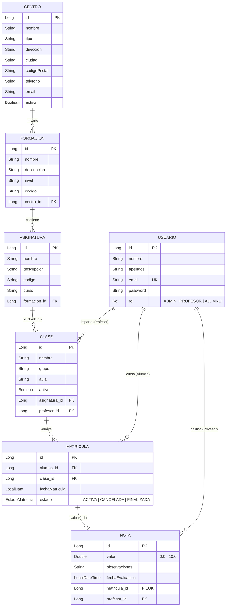

# 🎓 Gestión Baleras - API REST

[](https://openjdk.org/projects/jdk/21/)
[](https://spring.io/projects/spring-boot)
[](https://spring.io/projects/spring-security)
[](https://www.postgresql.org/)
[](#)

API REST robusta y modular para la gestión académica y administrativa de centros formativos e institutos educativos (**Gestión Baleras**). Proporciona un sistema integral con autenticación stateless mediante **JWT**, control de acceso basado en roles (**RBAC: ADMIN, PROFESOR, ALUMNO**), validación declarativa de datos y arquitectura en capas desacopladas.

---

## 📋 Tabla de Contenidos

1. [Descripción y Propósito](#-descripción-y-propósito)
2. [Arquitectura del Sistema](#-arquitectura-del-sistema)
3. [Modelo de Dominio y Entidades](#-modelo-de-dominio-y-entidades)
4. [Seguridad y Control de Acceso (RBAC)](#-seguridad-y-control-de-acceso-rbac)
5. [Estructura del Proyecto](#-estructura-del-proyecto)
6. [Catálogo de Endpoints de la API](#-catálogo-de-endpoints-de-la-api)
   - [Autenticación (`/api/auth`)](#1-autenticación-apiauth)
   - [Centros (`/api/centros`)](#2-centros-apicentros)
   - [Formaciones (`/api/formaciones`)](#3-formaciones-apiformaciones)
   - [Asignaturas (`/api/asignaturas`)](#4-asignaturas-apiasignaturas)
   - [Clases (`/api/clases`)](#5-clases-apiclases)
   - [Matrículas (`/api/matriculas`)](#6-matrículas-apimatriculas)
   - [Calificaciones / Notas (`/api/notas`)](#7-calificaciones--notas-apinotas)
   - [Usuarios (`/api/usuarios`)](#8-usuarios-apiusuarios)
7. [Manejo Centralizado de Excepciones](#-manejo-centralizado-de-excepciones)
8. [Configuración y Variables de Entorno](#-configuración-y-variables-de-entorno)
9. [Instalación y Despliegue Local](#-instalación-y-despliegue-local)
10. [Flujo de Ejemplo con cURL](#-flujo-de-ejemplo-con-curl)

---

## 💡 Descripción y Propósito

**Gestión Baleras** centraliza el ciclo de vida educativo de uno o varios centros formativos:
- **Estructura Académica:** Jerarquía completa desde Centros educativos $\rightarrow$ Formaciones (ciclos formativos/grados) $\rightarrow$ Asignaturas $\rightarrow$ Clases (grupos y aulas).
- **Gestión de Usuarios:** Separación estricta de responsabilidades entre Administradores, Docentes y Estudiantes.
- **Matriculación:** Inscripción de alumnos a clases específicas garantizando restricciones de unicidad y control de estado (`ACTIVA`, `CANCELADA`, `FINALIZADA`).
- **Evaluación y Calificaciones:** Emisión, actualización y auditoría de notas numéricas (0 a 10) con observaciones, blindadas para que únicamente el profesor titular de la clase pueda calificar a sus alumnos matriculados.

---

## 🏛️ Arquitectura del Sistema

El proyecto sigue una arquitectura en capas (**Layered Architecture**) limpia y extensible:

```
                  ┌───────────────────────────────┐
                  │      Cliente HTTP / Frontend   │
                  └──────────────┬────────────────┘
                                 │ HTTP + JWT Bearer
                                 ▼
                  ┌───────────────────────────────┐
                  │    JwtAuthenticationFilter    │
                  └──────────────┬────────────────┘
                                 │
                  ┌──────────────▼────────────────┐
                  │         Controllers           │  <- @PreAuthorize, Validación DTOs (@Valid)
                  └──────────────┬────────────────┘
                                 │ DTOs (Records)
                  ┌──────────────▼────────────────┐
                  │           Services            │  <- Lógica de negocio y autorizaciones complejas
                  └──────────────┬────────────────┘
                                 │ Entities (JPA)
                  ┌──────────────▼────────────────┐
                  │         Repositories          │  <- Spring Data JPA
                  └──────────────┬────────────────┘
                                 │ SQL
                  ┌──────────────▼────────────────┐
                  │       PostgreSQL Database     │
                  └───────────────────────────────┘
```

---

## 🗄️ Modelo de Dominio y Entidades

### Diagrama Entidad-Relación



### Reglas de Integridad Clave:
1. **Unicidad de Matrícula (`uk_alumno_clase`):** Un alumno no puede matricularse dos veces en la misma clase.
2. **Unicidad de Nota por Matrícula (`uk_nota_matricula`):** Cada matrícula posee como máximo una nota registrada.
3. **Email Único en Usuario:** Garantiza credenciales unívocas para la autenticación.
4. **Validación de Roles en Relaciones:** No se puede asignar como profesor de una clase a un usuario cuyo rol no sea `PROFESOR`, ni matricular a un usuario que no tenga el rol `ALUMNO`.

---

## 🔐 Seguridad y Control de Acceso (RBAC)

El proyecto utiliza **Spring Security** en modo **Stateless** combinado con **JWT (JSON Web Token)** y **BCrypt** para el cifrado seguro de contraseñas.

### Matriz de Permisos por Rol

| Módulo / Recurso | Operación | ADMIN | PROFESOR | ALUMNO | Observaciones |
| :--- | :--- | :---: | :---: | :---: | :--- |
| **Auth** | Registro / Login | ✅ | ✅ | ✅ | `/api/auth/register` crea usuarios `ALUMNO` por defecto. |
| **Usuarios** | Lectura (`GET`) | ✅ | ✅ | ❌ | Listado general o por identificador. |
| **Usuarios** | Creación / Edición / Baja | ✅ | ❌ | ❌ | Solo el ADMIN gestiona cuentas de usuario. |
| **Centros** | Lectura (`GET`) | ✅ | ✅ | ❌ | Consulta de centros. |
| **Centros** | Creación / Edición / Baja | ✅ | ❌ | ❌ | Gestión de sedes educativas. |
| **Formaciones** | Lectura (`GET`) | ✅ | ✅ | ❌ | Ciclos y grados disponibles. |
| **Formaciones** | Creación / Edición / Baja | ✅ | ❌ | ❌ | Configuración curricular. |
| **Asignaturas** | Lectura (`GET`) | ✅ | ✅ | ❌ | Materias del plan formativo. |
| **Asignaturas** | Creación / Edición / Baja | ✅ | ❌ | ❌ | Configuración curricular. |
| **Clases** | Lectura (`GET`) | ✅ | 🔍 *(Propias)* | ❌ | Profesores solo ven sus clases asignadas. |
| **Clases** | Endpoint `/mis-clases` | ❌ | ✅ | ❌ | Lista directa de clases del profesor autenticado. |
| **Clases** | Creación / Edición / Baja | ✅ | ❌ | ❌ | Alta y configuración de aulas/grupos. |
| **Matrículas** | Consulta por Clase | ✅ | 🔍 *(Propias)* | ❌ | Profesores solo consultan matrículas de sus clases. |
| **Matrículas** | Consulta por Alumno | ✅ | 🔍 *(Si le da clase)* | 🔍 *(Solo suyas)* | Alumnos solo pueden consultar su propio historial. |
| **Matrículas** | Alta / Modificación / Baja | ✅ | ❌ | ❌ | Trámite administrativo exclusivo de Secretaría/Admin. |
| **Notas** | Listado general | ✅ | ✅ | ❌ | Auditoría de notas. |
| **Notas** | Mis notas (`/mis-notas`) | ❌ | ❌ | ✅ | Consulta privada para el alumno autenticado. |
| **Notas** | Crear / Modificar / Borrar | ❌ | 🔍 *(Titular)* | ❌ | **Solo el profesor titular** de la clase puede calificar. |

---

## 📁 Estructura del Proyecto

```
Gestion Baleras/
├── pom.xml                               # Dependencias Maven y configuración del build
├── mvnw / mvnw.cmd                       # Maven Wrapper
└── src/
    ├── main/
    │   ├── java/com/baleras/api/
    │   │   ├── GestionBalerasApplication.java  # Clase principal Spring Boot (@EnableMethodSecurity)
    │   │   ├── config/                         # Configuraciones (Security, JWT)
    │   │   │   ├── JwtConfig.java              # Mapeo de propiedades 'jwt.*'
    │   │   │   └── SecurityConfig.java         # Filtros HTTP, BCrypt, rutas públicas y privadas
    │   │   ├── Controller/                     # Endpoints REST (Controladores)
    │   │   │   ├── AsignaturaController.java
    │   │   │   ├── AuthController.java
    │   │   │   ├── CentroController.java
    │   │   │   ├── ClaseController.java
    │   │   │   ├── FormacionController.java
    │   │   │   ├── MatriculaController.java
    │   │   │   ├── NotaController.java
    │   │   │   └── UsuarioController.java
    │   │   ├── Dto/                            # DTOs de Request y Response (Java Records)
    │   │   ├── Entity/                         # Entidades JPA y Enums de dominio
    │   │   │   ├── Asignatura.java
    │   │   │   ├── Centro.java
    │   │   │   ├── Clase.java
    │   │   │   ├── EstadoMatricula.java        # ACTIVA, CANCELADA, FINALIZADA
    │   │   │   ├── Formacion.java
    │   │   │   ├── Matricula.java
    │   │   │   ├── Nota.java
    │   │   │   ├── Rol.java                    # ADMIN, PROFESOR, ALUMNO
    │   │   │   └── Usuario.java
    │   │   ├── Exception/                      # Gestión de excepciones y errores de API
    │   │   │   ├── AccessDeniedException.java
    │   │   │   ├── ApiError.java               # Estructura JSON estandarizada de errores
    │   │   │   ├── DuplicateResourceException.java
    │   │   │   ├── GlobalExceptionHandler.java # @RestControllerAdvice
    │   │   │   ├── InvalidCredentialException.java
    │   │   │   └── ResourceNotFoundException.java
    │   │   ├── Repository/                     # Interfaces Spring Data JPA
    │   │   ├── Security/                       # Componentes de seguridad JWT
    │   │   │   └── JwtAuthenticationFilter.java# Filtro OncePerRequestFilter
    │   │   └── Service/                        # Capa de lógica de negocio y validación de seguridad
    │   │       ├── AsignaturaService.java
    │   │       ├── AuthService.java
    │   │       ├── CentroService.java
    │   │       ├── ClaseService.java
    │   │       ├── FormacionService.java
    │   │       ├── JwtService.java
    │   │       ├── MatriculaService.java
    │   │       ├── NotaService.java
    │   │       ├── UsuarioActualService.java   # Helper para obtener el usuario autenticado
    │   │       └── UsuarioService.java
    │   └── resources/
    │       └── application.properties          # Configuración de base de datos, JPA y JWT
    └── test/
        └── java/com/baleras/api/
            └── GestionBalerasApplicationTests.java
```

---

## 📡 Catálogo de Endpoints de la API

> 💡 **Nota sobre autenticación:** Todos los endpoints excepto `/api/auth/**` requieren incluir la cabecera:
> `Authorization: Bearer <TOKEN_JWT>`

### 1. Autenticación (`/api/auth`)

| Método | Endpoint | Acceso | Descripción |
| :--- | :--- | :--- | :--- |
| `POST` | `/api/auth/register` | Público | Registra un nuevo usuario con rol `ALUMNO`. |
| `POST` | `/api/auth/login` | Público | Inicia sesión y devuelve token JWT con los datos de usuario. |

<details>
<summary>▶ Ver ejemplos de Request / Response (Auth)</summary>

**POST `/api/auth/login` - Request:**
```json
{
  "email": "profesor@baleras.com",
  "password": "Password123"
}
```

**POST `/api/auth/login` - Response (200 OK):**
```json
{
  "id": 1,
  "nombre": "Carlos",
  "email": "profesor@baleras.com",
  "rol": "PROFESOR",
  "token": "eyJhbGciOiJIUzI1NiJ9..."
}
```
</details>

---

### 2. Centros (`/api/centros`)

| Método | Endpoint | Roles Permitidos | Descripción |
| :--- | :--- | :--- | :--- |
| `GET` | `/api/centros` | `ADMIN`, `PROFESOR` | Lista todos los centros educativos. |
| `GET` | `/api/centros/{id}` | `ADMIN`, `PROFESOR` | Obtiene un centro por ID. |
| `POST` | `/api/centros` | `ADMIN` | Registra un nuevo centro. |
| `PUT` | `/api/centros/{id}` | `ADMIN` | Actualiza los datos de un centro. |
| `DELETE` | `/api/centros/{id}` | `ADMIN` | Elimina un centro. |

<details>
<summary>▶ Ver estructura del cuerpo de Centro</summary>

**POST / PUT `/api/centros` - Request:**
```json
{
  "nombre": "Campus Central Baleras",
  "tipo": "Instituto Tecnológico",
  "direccion": "Calle Mayor 123",
  "ciudad": "Madrid",
  "codigoPostal": "28001",
  "telefono": "+34912345678",
  "email": "contacto@baleras.edu"
}
```
</details>

---

### 3. Formaciones (`/api/formaciones`)

| Método | Endpoint | Roles Permitidos | Descripción |
| :--- | :--- | :--- | :--- |
| `GET` | `/api/formaciones` | `ADMIN`, `PROFESOR` | Obtiene todas las formaciones. |
| `GET` | `/api/formaciones/{id}` | `ADMIN`, `PROFESOR` | Obtiene una formación por ID. |
| `GET` | `/api/formaciones/centro/{centroId}` | `ADMIN`, `PROFESOR` | Formaciones impartidas en un centro. |
| `POST` | `/api/formaciones` | `ADMIN` | Crea una nueva formación ligada a un centro. |
| `PUT` | `/api/formaciones/{id}` | `ADMIN` | Modifica una formación existente. |
| `DELETE` | `/api/formaciones/{id}` | `ADMIN` | Elimina una formación. |

<details>
<summary>▶ Ver estructura del cuerpo de Formación</summary>

**POST / PUT `/api/formaciones` - Request:**
```json
{
  "nombre": "Desarrollo de Aplicaciones Web",
  "descripcion": "Ciclo Formativo de Grado Superior en DAW",
  "nivel": "Grado Superior",
  "codigo": "DAW-2026",
  "centroId": 1
}
```
</details>

---

### 4. Asignaturas (`/api/asignaturas`)

| Método | Endpoint | Roles Permitidos | Descripción |
| :--- | :--- | :--- | :--- |
| `GET` | `/api/asignaturas` | `ADMIN`, `PROFESOR` | Lista todas las asignaturas. |
| `GET` | `/api/asignaturas/{id}` | `ADMIN`, `PROFESOR` | Obtiene una asignatura por su ID. |
| `GET` | `/api/asignaturas/formacion/{formacionId}` | `ADMIN`, `PROFESOR` | Asignaturas pertenecientes a una formación. |
| `POST` | `/api/asignaturas` | `ADMIN` | Registra una asignatura ligada a una formación. |
| `PUT` | `/api/asignaturas/{id}` | `ADMIN` | Actualiza una asignatura. |
| `DELETE` | `/api/asignaturas/{id}` | `ADMIN` | Borra una asignatura. |

<details>
<summary>▶ Ver estructura del cuerpo de Asignatura</summary>

**POST / PUT `/api/asignaturas` - Request:**
```json
{
  "nombre": "Desarrollo Web en Entorno Servidor",
  "descripcion": "Backend con Spring Boot, JPA y Arquitectura de Microservicios",
  "codigo": "DWES-02",
  "curso": "2º Curso",
  "formacionId": 1
}
```
</details>

---

### 5. Clases (`/api/clases`)

| Método | Endpoint | Roles Permitidos | Descripción |
| :--- | :--- | :--- | :--- |
| `GET` | `/api/clases` | `ADMIN`, `PROFESOR` | Lista clases (ADMIN ve todas; PROFESOR sus asignadas). |
| `GET` | `/api/clases/{id}` | `ADMIN`, `PROFESOR` | Detalle de la clase (validando titularidad en docente). |
| `GET` | `/api/clases/mis-clases` | `PROFESOR` | Lista las clases impartidas por el docente en sesión. |
| `GET` | `/api/clases/asignatura/{asignaturaId}` | `ADMIN`, `PROFESOR` | Clases de una asignatura específica. |
| `GET` | `/api/clases/profesor/{profesorId}` | `ADMIN`, `PROFESOR` | Clases asignadas a un docente. |
| `POST` | `/api/clases` | `ADMIN` | Crea una clase asociando Asignatura y Profesor. |
| `PUT` | `/api/clases/{id}` | `ADMIN` | Modifica datos o profesor de una clase. |
| `DELETE` | `/api/clases/{id}` | `ADMIN` | Elimina una clase. |

<details>
<summary>▶ Ver estructura del cuerpo de Clase</summary>

**POST / PUT `/api/clases` - Request:**
```json
{
  "nombre": "DWES - Mañana",
  "grupo": "DAW2-A",
  "aula": "Aula 204",
  "asignaturaId": 1,
  "profesorId": 2
}
```
</details>

---

### 6. Matrículas (`/api/matriculas`)

| Método | Endpoint | Roles Permitidos | Descripción |
| :--- | :--- | :--- | :--- |
| `GET` | `/api/matriculas` | `ADMIN`, `PROFESOR` | Lista general de matrículas. |
| `GET` | `/api/matriculas/{id}` | `ADMIN`, `PROFESOR` | Detalle de una matrícula por ID. |
| `GET` | `/api/matriculas/clase/{claseId}` | `ADMIN`, `PROFESOR` | Alumnos matriculados en una clase (profesor titular). |
| `GET` | `/api/matriculas/alumno/{alumnoId}` | `ADMIN`, `PROFESOR`, `ALUMNO` | Historial de matrículas de un alumno. |
| `POST` | `/api/matriculas` | `ADMIN` | Matricula un alumno en una clase activa. |
| `PUT` | `/api/matriculas/{id}` | `ADMIN` | Modifica estado o datos de la matrícula. |
| `DELETE` | `/api/matriculas/{id}` | `ADMIN` | Elimina una matrícula. |

<details>
<summary>▶ Ver estructura del cuerpo de Matrícula</summary>

**POST / PUT `/api/matriculas` - Request:**
```json
{
  "alumnoId": 5,
  "claseId": 1,
  "estado": "ACTIVA"
}
```
*Estados válidos:* `ACTIVA`, `CANCELADA`, `FINALIZADA`.
</details>

---

### 7. Calificaciones / Notas (`/api/notas`)

| Método | Endpoint | Roles Permitidos | Descripción |
| :--- | :--- | :--- | :--- |
| `GET` | `/api/notas` | `ADMIN`, `PROFESOR` | Listado general de calificaciones registradas. |
| `GET` | `/api/notas/mis-notas` | `ALUMNO` | Consulta exclusiva de las calificaciones del alumno en sesión. |
| `GET` | `/api/notas/{id}` | `ADMIN`, `PROFESOR`, `ALUMNO` | Obtiene una nota específica por ID. |
| `GET` | `/api/notas/matricula/{matriculaId}` | `ADMIN`, `PROFESOR`, `ALUMNO` | Nota asociada a una matrícula. |
| `GET` | `/api/notas/alumno/{alumnoId}` | `ADMIN`, `PROFESOR`, `ALUMNO` | Todas las notas de un alumno. |
| `GET` | `/api/notas/profesor/{profesorId}` | `ADMIN`, `PROFESOR` | Notas emitidas por un profesor. |
| `POST` | `/api/notas` | `PROFESOR` | Califica una matrícula (solo el docente titular de la clase). |
| `PUT` | `/api/notas/{id}` | `PROFESOR` | Actualiza la calificación u observaciones. |
| `DELETE` | `/api/notas/{id}` | `PROFESOR` | Elimina una calificación registrada. |

<details>
<summary>▶ Ver estructura del cuerpo de Nota</summary>

**POST / PUT `/api/notas` - Request:**
```json
{
  "valor": 8.75,
  "observaciones": "Excelente proyecto final y participación en clase.",
  "matriculaId": 12
}
```

**Response (201 CREATED / 200 OK):**
```json
{
  "id": 1,
  "valor": 8.75,
  "observaciones": "Excelente proyecto final y participación en clase.",
  "fechaEvaluacion": "2026-10-27T15:30:00",
  "matriculaId": 12,
  "alumnoId": 5,
  "alumnoNombre": "Lucía",
  "claseId": 1,
  "claseNombre": "DWES - Mañana",
  "asignaturaId": 1,
  "asignaturaNombre": "Desarrollo Web en Entorno Servidor",
  "profesorId": 2,
  "profesorNombre": "Carlos"
}
```
</details>

---

### 8. Usuarios (`/api/usuarios`)

| Método | Endpoint | Roles Permitidos | Descripción |
| :--- | :--- | :--- | :--- |
| `GET` | `/api/usuarios` | `ADMIN`, `PROFESOR` | Listado general de usuarios del sistema. |
| `GET` | `/api/usuarios/{id}` | `ADMIN`, `PROFESOR` | Obtiene información de un usuario por ID. |
| `POST` | `/api/usuarios` | `ADMIN` | Alta de usuarios con rol explícito (`ADMIN`, `PROFESOR`, `ALUMNO`). |
| `PUT` | `/api/usuarios/{id}` | `ADMIN` | Modificación de datos o rol de usuario. |
| `DELETE` | `/api/usuarios/{id}` | `ADMIN` | Baja de un usuario. |

---

## ⚠️ Manejo Centralizado de Excepciones

Todas las excepciones del sistema son capturadas por el componente `GlobalExceptionHandler` y devueltas en un formato uniforme `ApiError`:

```json
{
  "timestamp": "2026-10-27T15:35:10.123456",
  "status": 400,
  "error": "Validation Error",
  "message": "Hay errores en la solicitud",
  "errors": {
    "valor": "La nota no puede ser superior a 10",
    "matriculaId": "La matrícula es obligatoria"
  }
}
```

### Mapeo de Códigos HTTP:

| Código HTTP | Nombre | Excepción Java | Causa típica |
| :--- | :--- | :--- | :--- |
| `400 BAD REQUEST` | Validation Error | `MethodArgumentNotValidException` | Datos inválidos o faltantes en el cuerpo de la petición. |
| `401 UNAUTHORIZED` | Unauthorized | `InvalidCredentialException` | Credenciales incorrectas en login o token inválido/expirado. |
| `403 FORBIDDEN` | Forbidden | `AccessDeniedException` | Falta de permisos (ej: profesor intentando modificar notas ajenas). |
| `404 NOT FOUND` | Not Found | `ResourceNotFoundException` | El recurso solicitado por ID no existe en la base de datos. |
| `409 CONFLICT` | Conflict | `DuplicateResourceException` | Violación de unicidad (email existente, matrícula duplicada, etc.). |

---

## ⚙️ Configuración y Variables de Entorno

El archivo [application.properties](src/main/resources/application.properties) parametriza la conexión a base de datos y la clave de firmado criptográfico:

```properties
spring.application.name=Gestion Baleras
spring.datasource.url=${DB_URL}
spring.datasource.username=${DB_USERNAME}
spring.datasource.password=${DB_PASSWORD}
jwt.secret=${JWT_SECRET}

spring.jpa.hibernate.ddl-auto=update
spring.jpa.show-sql=true
spring.jpa.properties.hibernate.format_sql=true
```

### Variables Requeridas

| Variable | Descripción | Ejemplo |
| :--- | :--- | :--- |
| `DB_URL` | Cadena JDBC de conexión a PostgreSQL | `jdbc:postgresql://localhost:5432/gestion_baleras` |
| `DB_USERNAME` | Usuario de la base de datos | `postgres` |
| `DB_PASSWORD` | Contraseña del usuario de la BD | `postgres123` |
| `JWT_SECRET` | Clave secreta para firmar tokens JWT (mínimo 256 bits) | `MiClaveSuperSecretaYExtremadamenteLargaParaFirmarJWT2026` |

---

## 🚀 Instalación y Despliegue Local

### Requisitos Previos
- **Java JDK 21** o superior instalado.
- **PostgreSQL 14+** en ejecución con una base de datos creada (ej. `gestion_baleras`).
- **Git** y terminal compatible (PowerShell, Bash, Zsh).

### Paso 1: Clonar el Repositorio
```bash
git clone https://github.com/Rauloo95/gestion_instituto.git
cd gestion_instituto
```

### Paso 2: Crear la Base de Datos
En tu consola de PostgreSQL (`psql`) o herramienta cliente (pgAdmin, DBeaver):
```sql
CREATE DATABASE gestion_baleras;
```

### Paso 3: Configurar Variables de Entorno

**En Windows (PowerShell):**
```powershell
$env:DB_URL="jdbc:postgresql://localhost:5432/gestion_baleras"
$env:DB_USERNAME="postgres"
$env:DB_PASSWORD="tu_password"
$env:JWT_SECRET="ClaveSecretaDeAlMenos32CaracteresDeLongitudParaHmacSha"
```

**En Linux / macOS (Bash):**
```bash
export DB_URL="jdbc:postgresql://localhost:5432/gestion_baleras"
export DB_USERNAME="postgres"
export DB_PASSWORD="tu_password"
export JWT_SECRET="ClaveSecretaDeAlMenos32CaracteresDeLongitudParaHmacSha"
```

### Paso 4: Compilar y Ejecutar la Aplicación

Con el Maven Wrapper incluido:

**Windows:**
```powershell
.\mvnw.cmd spring-boot:run
```

**Linux / macOS:**
```bash
./mvnw spring-boot:run
```

La aplicación arrancará por defecto en el puerto `http://localhost:8080`.

---

## 🧪 Flujo de Ejemplo con cURL

A continuación se muestra un ciclo de vida típico para probar el flujo completo:

### 1. Iniciar sesión como Administrador y obtener Token
```bash
curl -X POST http://localhost:8080/api/auth/login \
  -H "Content-Type: application/json" \
  -d '{
    "email": "admin@baleras.com",
    "password": "AdminPassword123"
  }'
```

### 2. Crear un Centro Educativo (usando el Token)
```bash
curl -X POST http://localhost:8080/api/centros \
  -H "Content-Type: application/json" \
  -H "Authorization: Bearer <TOKEN_ADMIN>" \
  -d '{
    "nombre": "Instituto Baleras Palma",
    "tipo": "Centro Integrado de FP",
    "direccion": "Av. Alexandre Rosselló 15",
    "ciudad": "Palma de Mallorca",
    "codigoPostal": "07002",
    "telefono": "+34971000000",
    "email": "info@baleras-palma.edu"
  }'
```

### 3. Crear una Formación en el Centro
```bash
curl -X POST http://localhost:8080/api/formaciones \
  -H "Content-Type: application/json" \
  -H "Authorization: Bearer <TOKEN_ADMIN>" \
  -d '{
    "nombre": "Desarrollo de Aplicaciones Multiplataforma",
    "descripcion": "Ciclo Formativo Superior en DAM",
    "nivel": "Grado Superior",
    "codigo": "DAM-FP",
    "centroId": 1
  }'
```

### 4. Consultar Notas de Alumno autenticado (como Estudiante)
```bash
curl -X GET http://localhost:8080/api/notas/mis-notas \
  -H "Authorization: Bearer <TOKEN_ALUMNO>"
```

---

## 🛠️ Tecnologías Empleadas

- **Lenguaje:** [Java 21 (LTS)](https://openjdk.org/projects/jdk/21/)
- **Framework:** [Spring Boot 4.1.1](https://spring.io/projects/spring-boot)
  - Spring Boot Starter Web (MVC)
  - Spring Boot Starter Data JPA (Hibernate)
  - Spring Boot Starter Security
  - Spring Boot Starter Validation (Hibernate Validator)
- **Base de Datos:** [PostgreSQL](https://www.postgresql.org/)
- **Tokens de Seguridad:** [JJWT (Java JWT 0.13.0)](https://github.com/jwtk/jjwt)
- **Utilidades:** [Project Lombok](https://projectlombok.org/)
- **Gestor de Construcción:** [Apache Maven](https://maven.apache.org/)

---

## 📄 Licencia

Este proyecto es de uso educativo y académico dentro de la plataforma **Gestión Baleras**. Todos los derechos reservados.
